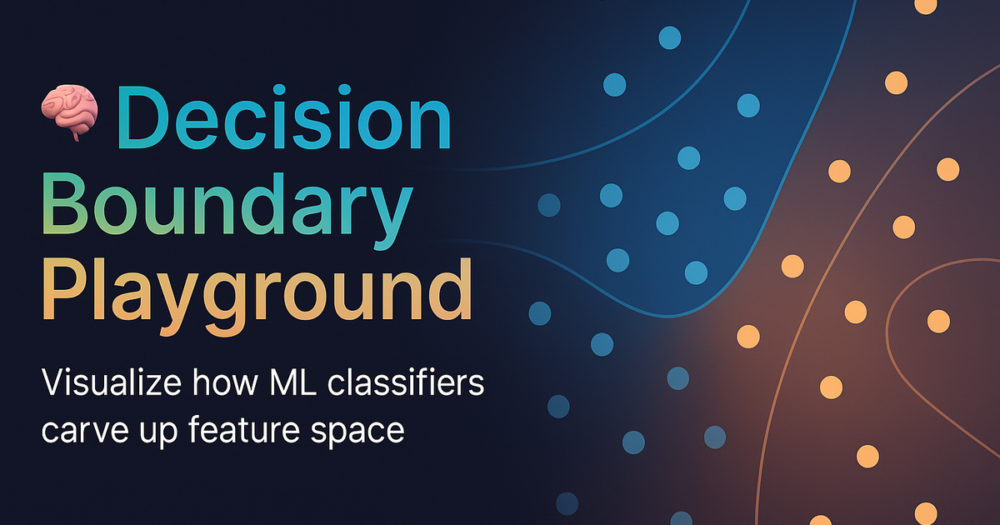

<p align="center">
  
</p>

# 🧠 Decision Boundary Playground

An interactive classification sandbox built with Streamlit, scikit-learn, and Plotly. Explore how models divide a two-dimensional feature space, then compare their results on the same held-out data.

[Launch the app](https://decision-boundary-playground.streamlit.app/) · [Smoke checks](https://github.com/Data-is-life/decision-boundary-playground/actions/workflows/smoke.yml) · [MIT license](LICENSE)

## Run locally

Use Python 3.11, matching the app runtime and CI configuration.

```bash
git clone https://github.com/Data-is-life/decision-boundary-playground.git
cd decision-boundary-playground
python -m venv .venv
```

Activate the environment:

```bash
# macOS / Linux
source .venv/bin/activate
```

```powershell
# Windows PowerShell
.\.venv\Scripts\Activate.ps1
```

Install the dependencies and start the app:

```bash
python -m pip install -r requirements.txt
python -m streamlit run app.py
```

Open the local URL printed by Streamlit, usually http://localhost:8501.

XGBoost appears in the estimator menu when it imports successfully. The requirements omit it on Apple Silicon macOS; the other four estimators remain available.

### Docker

From the repository root:

```bash
docker build -t decision-boundary-playground .
docker run --rm -p 8501:8501 decision-boundary-playground
```

## Explore the playground

1. Choose a dataset or upload a CSV.
2. For synthetic datasets, adjust sample count, noise, and class balance.
3. Toggle standardization or polynomial features, then choose an estimator and its hyperparameters.
4. Inspect the decision surface, test metrics, confusion matrix, and model comparison. Binary tasks also show a ROC curve.

The estimators are Logistic Regression, SVM (RBF), KNN, Random Forest, and optional XGBoost. The comparison tab uses fixed model settings with the same train/test split and feature-engineering settings; changing a selected estimator's hyperparameters affects its own results.

The random seed controls synthetic samples, downsampling, the train/test split, and stochastic model fits. Repeating the same settings in the same dependency environment makes these steps reproducible.

## Datasets

| Dataset | Features shown | Classes | Source |
| --- | --- | --- | --- |
| Blobs, Moons, Circles, XOR | x1, x2 | 2 | Generated locally |
| Iris | Sepal length, sepal width | 3 | Bundled with scikit-learn |
| Breast Cancer | Mean radius, mean texture | 2 | Bundled with scikit-learn |
| Wine | Alcohol, color intensity | 3 | Bundled with scikit-learn |
| Penguins | Bill length, flipper length | 3 | Seaborn download/cache |
| Titanic | Age, fare | 2 | Seaborn download/cache |
| Uploaded CSV | Your two selected feature columns | 2 or more | Your file |

Titanic and Penguins may need an internet connection on first use. If downloading or reading their cached data fails, the app shows a warning and a **Retry loading dataset** button. You can also switch to a local dataset or upload a CSV. Rows missing the fields required by these dataset loaders are removed.

### Class balance

**Class 1 proportion** applies only to Blobs, Moons, Circles, and XOR. It removes rows from the overrepresented class without duplicating rows. The app reports the actual proportion and retained sample count; rounding to whole rows can make the result differ slightly from the requested proportion.

This control does not rebalance real datasets or uploaded CSVs.

## Upload a CSV

Use a CSV with a header row and at least three columns. In the sidebar, select a target column and exactly two different feature columns, then choose **Uploaded CSV** in the dataset menu.

- Both selected features must contain finite numeric values.
- The selected features and target must have no missing values.
- Target labels can be consistently numeric or consistently text, including `yes/no`, `10/20`, or three or more class names.
- The target needs at least two distinct classes, with at least two rows per class.
- Both train and test sets must contain every class. Small datasets or rare classes may require more examples or a different **Test size**.
- For KNN, `k` must not exceed the number of training rows. The comparison tab skips KNN-7 with an explanation if fewer than seven training rows are available.

For example, save this as `example.csv`, choose `label` as the target, and select `height` and `weight` as features:

```csv
label,height,weight
no,150,45
no,153,47
no,156,49
no,159,51
no,162,53
no,165,55
yes,168,60
yes,171,63
yes,174,66
yes,177,69
yes,180,72
yes,183,75
```

This small example demonstrates the upload format; it is not a meaningful performance benchmark.

Labels are encoded internally as contiguous class IDs for model compatibility. Original labels remain visible in plot legends and confusion matrices, and are restored in downloaded CSVs. For binary tasks, the second label in sorted order is the positive class (for example, `yes` for `no/yes`); the app displays this choice beside the metrics and ROC curve.

Plot axes use the selected feature names. **Download dataset (CSV)** exports the current dataset before the train/test split with columns `x1`, `x2`, and `y`, preserving target labels. For synthetic datasets, it exports the rows retained after downsampling.

## Understand the results

| Task | Test metrics | Decision surface | ROC |
| --- | --- | --- | --- |
| Binary | Accuracy, precision, recall, F1, ROC AUC | Positive-class probability | Available |
| Multiclass | Accuracy, macro F1 | Predicted class | Binary-only guidance |

Confusion matrix rows are actual classes; columns are predicted classes. Test markers are outlined on the decision surface. Metrics describe the held-out split, so they can change when you change the seed, test size, or retained data.

### Try these experiments

| Settings | What to explore |
| --- | --- |
| XOR + Logistic Regression; toggle polynomial features, degree 3 | How feature engineering allows a linear estimator to express a nonlinear boundary |
| Moons + SVM (RBF); vary gamma and noise | How boundary flexibility responds to overlapping data |
| Blobs + Random Forest; vary tree depth | How tree partitions change the shape of decision regions |
| Moons; vary class balance | How accuracy, precision, and recall respond to downsampling |
| Iris + Logistic Regression | How multiclass regions and macro F1 differ from binary results |

## Automated checks

After installing the requirements, run from the repository root:

```bash
python -m unittest discover -s tests -v
```

The Streamlit AppTest suite runs the actual app on Moons (binary) and Iris (multiclass) for each available estimator. It checks metrics and comparison results, confusion matrix labels and totals, plot titles and axes, class legends, and binary ROC versus multiclass guidance.

GitHub Actions runs the same suite on pull requests, pushes to `main`, and manual workflow runs using Python 3.11. CI also checks that XGBoost imports. The smoke suite uses local datasets; CSV uploads and network-backed dataset loading are outside its coverage.

## License

[MIT](LICENSE) © Mohit Gangwani
